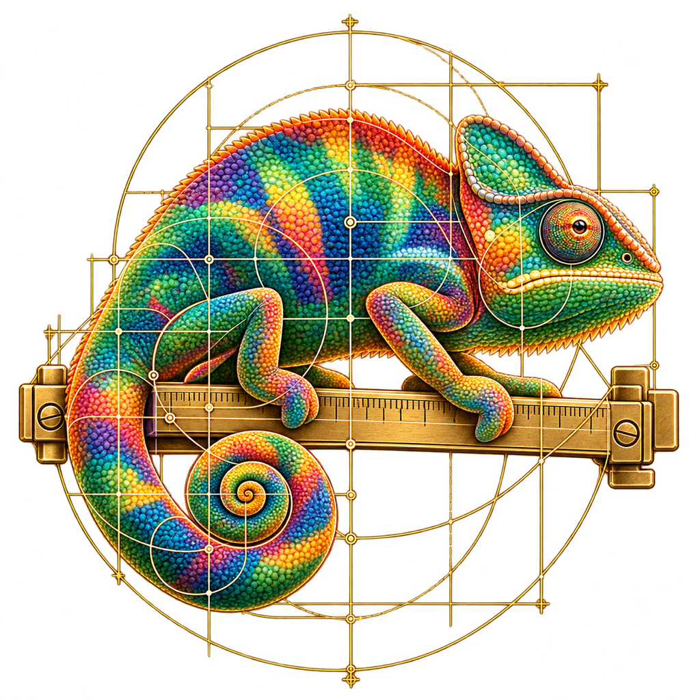

<p align="center">
  
</p>

# Plugin `design`

## Contents

- [Installation](#installation)
- [Overview](#overview)
- [Commands](#commands)
- [Rules](#rules)
- [Project artifacts](#project-artifacts)
- [Integrations and runtime](#integrations-and-runtime)
- [Files](#files)
- [Use cases](USAGE.md)
- [Release notes](CHANGELOG.md)

## Installation

```bash
claude plugin marketplace add kamoca-labs/marketplace
claude plugin install design@kamoca
```

The commands appear in the next session. Update steps are in the [marketplace guide](https://github.com/kamoca-labs/marketplace/blob/main/USAGE.md#update-after-editing). Impeccable is bundled; a separate installation is not required.

With craft's `atdd-first` hook enabled, use craft 0.16.0 or later. Python 3.9+ is needed only for this repository's verification script. Optional design tools have their own runtime and authentication requirements.

## Overview

Design systems and complete interfaces, with **a reviewable mockup before product implementation**. The entry point `/design:design` reads project context, prepares applicable screen states and responsive variants, and iterates with the user. Implementation starts after explicit approval of the current proposal.

`/design:setup` records the existing system in DESIGN.md. Token files and components define runtime values; the document explains their roles. Missing documentation does not authorize replacing an established identity.

The plugin extends pinned Impeccable guidance with setup, alternating backgrounds, state coverage, responsive checks and mockup approval. Behavior follows the project's test workflow, including `/craft:atdd` when applicable. Visual-only work uses `/design:style`.

## Commands

| Command | Arguments | What it does |
|---|---|---|
| `/design:design` | `[action or request] [target]` | Main entry point. Prepares a state-complete responsive proposal before implementation approval; supports bundled actions such as typeset, animate, shape, harden and polish |
| `/design:setup` | `[project or scope]` | Inspects themes, typography, components and breakpoints; creates or merges DESIGN.md from evidence |
| `/design:style` | `<visual change>` | Iterates a visual-only mockup, implements the approved proposal and runs relevant existing functional checks |
| `/design:mockup` | `[screen or idea]` | Creates an inspectable local artifact or Figma/FigCraft draft with applicable states and responsive compositions |
| `/design:states` | `[screen or flow]` | Defines variants, triggers, recovery, preserved input and verification evidence |
| `/design:system` | `[scope]` | Consolidates tokens and patterns while preserving the stack and approved identity |
| `/design:connect` | `[figma\|figcraft\|tool]` | Discovers tools and configures the requested optional MCP integration |
| `/design:review` | `[scope]` | Reviews rendered UI, contrast, accessibility, responsiveness and state coverage; fixes only when requested |

Plugin commands carry the prefix: `/design:design`, not `/design` alone.

### Sub-skills

These stay out of the slash menu (`user-invocable: false`). Entry points load the relevant skills through the Skill tool. State and responsive assessment apply to every UI change.

| Skill | Topic |
|---|---|
| `design:colors` | Alternating neutral backgrounds, paired foregrounds, actions, statuses and themes |
| `design:contrast` | Measured text, control and focus contrast on actual backgrounds |
| `design:typography` | Text roles, loading, hierarchy, reading, localization and numeric content |
| `design:patterns` | Navigation, forms, tables, filters, dialogs, feedback and assets |
| `design:motion` | Purposeful animation, shared tokens, interruption and reduced motion |
| `design:responsive` | Shared breakpoints, content-driven adaptation and intermediate widths |
| `design:figma` | Structured context, variables, assets, component mappings and requested canvas work |
| `design:figcraft` | Frames, auto layout, components, variants, prototypes and rendered checks |

## Rules

| Rule | How it applies |
|---|---|
| Mockup before implementation | Present applicable states and responsive variants, then wait for explicit approval. Reuse approval for the same proposal/scope; substantial changes return to review |
| Complete states | Assess main, first-use, empty, no-results, loading, submitting, success, error, offline, access, destructive and content-extreme states. Document non-applicable categories |
| Responsive at every state | Reuse project breakpoints. Check representative widths, intermediate sizes and the edges of changed breakpoints, with relevant states, long content and zoom |
| Alternating backgrounds | Nested neutral containers use `bg-1 → bg-2 → bg-1`. Count meaningful groups, not every DOM wrapper |
| Paired foregrounds | Each background has its text/icon partner. Actions, statuses, fields and overlays retain their semantic roles; measure actual contrast |
| Behavior tests | Test actions, outcomes, functional visibility and semantics. Never assert decorative colors, exact sizes, CSS classes, spacing or animation time. A separate screenshot suite requires an explicit request |
| Rendered verification | Inspect affected routes, widths, themes and states. Report evidence and checks that could not run |
| Preserve scope | Reuse existing tokens and components. Report unrelated defects rather than turning a small change into a redesign |

These are skill instructions. This version installs no design detector hook or mechanical mockup-approval gate. The craft hook recognizes the loaded `design:style` flow; it does not independently validate approval records.

## Project artifacts

| Artifact | Purpose |
|---|---|
| `DESIGN.md` | System decisions, semantic roles, typography, layout and component conventions |
| Existing theme/token/component files | Authoritative runtime values and APIs |
| `docs/design/states/<screen>.md` | Applicable variants, triggers, recovery and evidence |
| `docs/design/mockups/<screen>/` | Local proposals, separate from production source, with approval records |
| Optional PRODUCT.md and `.impeccable/` files | Preserve upstream context compatibility |

Fill templates from project evidence. The starter palette is an example, not an automatic brand replacement. Map existing token names in DESIGN.md. Connector configuration belongs to the target project.

## Integrations and runtime

Figma and the standalone FigCraft editor are optional. Inspect actual capabilities, preserve other MCP settings and verify the requested connection. Configuration examples bundle no credentials; installation does not supply account access.

Impeccable 4.8.0 is under `upstream/impeccable/`, pinned by commit and Git blob hashes in `upstream.lock.json`. Local entry points read its guidance rather than registering a second skill. Its launcher may download a checksum-verified native engine on first use. Use the documented fallback when unavailable; report checks that did not run.

The root CLAUDE.md is maintainer guidance; runtime instructions live in skills. See [UPSTREAM.md](UPSTREAM.md) for updates.

## Files

| Path | Role |
|---|---|
| `.claude-plugin/plugin.json` | Metadata and version |
| `skills/<command>/SKILL.md` | Public commands and private domain guidance |
| `skills/design/references/workflow.md` | Shared context, approval and verification workflow |
| `skills/setup/assets/DESIGN.md` | Project-system template |
| `skills/states/assets/surface.md` | State contract template |
| `skills/colors/assets/theme.css` | Paired neutral-background example |
| `skills/{figma,figcraft}/assets/mcp.example.json` | Optional connector configuration fragments |
| `upstream/impeccable/` and `upstream.lock.json` | Unmodified pinned distribution and inventory |
| `scripts/verify.py` | Static package, link, upstream-integrity and sample-contrast checks |
| [USAGE.md](USAGE.md) | Workflow examples |
| [CHANGELOG.md](CHANGELOG.md) | Release notes |

Run `python3 scripts/verify.py` and `claude plugin validate .`. These do not prove live connector behavior, rendered layouts or application-wide accessibility.

## Sources and licensing

Local extensions use [MIT](LICENSE). Bundled [Impeccable](https://github.com/pbakaus/impeccable) uses Apache-2.0; its [license](upstream/impeccable/LICENSE) and [notices](upstream/impeccable/NOTICE.md) are retained. No upstream affiliation or review is implied.

Contrast guidance refers to [WCAG text contrast](https://www.w3.org/WAI/WCAG22/Understanding/contrast-minimum.html) and [non-text contrast](https://www.w3.org/WAI/WCAG22/Understanding/non-text-contrast.html).
